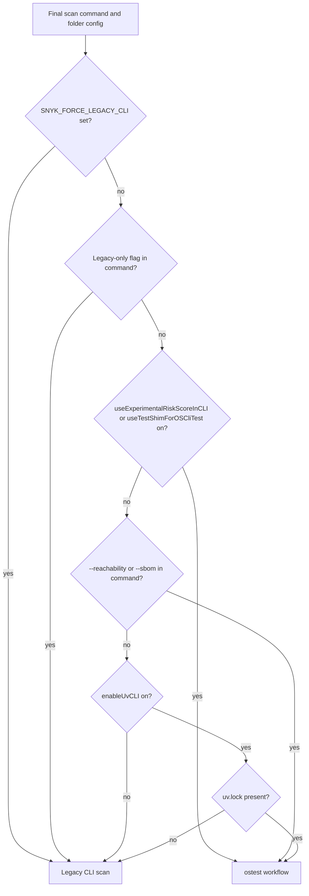

## Open Source scan routing

snyk-ls runs each Open Source scan one of two ways:

- The legacy CLI scan runs the assembled `snyk test --json` command through the CLI executor.
- The ostest workflow invokes the GAF `test` workflow from cli-extension-os-flows in-process.

`shouldUseLegacyScan` in `infrastructure/oss/cli_scanner.go` picks one per scan. It copies the routing rules of `ShouldUseLegacyFlow` in os-flows, so the IDE and `snyk test` in a terminal take the same path for the same project. It runs on the final command, after `prepareScanCommand` has added `--all-projects` or dropped it because of a conflicting parameter such as `--file`.

### Precedence

The first matching rule wins:

1. `SNYK_FORCE_LEGACY_CLI` is set in the environment. Legacy.
2. The command has a legacy-only flag: `--print-graph`, `--print-deps`, `--print-dep-paths` or `--unmanaged`. Legacy.
3. A new-flow condition holds. ostest. The conditions, checked in this order:
   - the folder org has `useExperimentalRiskScoreInCLI` on
   - the folder org has `useTestShimForOSCliTest` on
   - the command has `--reachability` or `--sbom`
   - the folder org has `enableUvCLI` on and a `uv.lock` is present
4. Otherwise legacy.

Feature flags come from the folder's organization and live on the folder config, so routing reads cached values and makes no network call.

### uv.lock detection

snyk-ls checks `enableUvCLI` before it touches the filesystem. Organizations without the flag pay nothing for the uv rule.

With the flag on, `uv.HasUvLockFile` from cli-extension-dep-graph does the search. os-flows calls the same helper, so the two agree on edge cases. Its inputs come from the final command:

- With `--all-projects`, it walks the folder recursively, skips `node_modules` and `.build`, and stops at the first `uv.lock`.
- Without `--all-projects`, it checks the `--file` target if that file is named `uv.lock`, and the folder root otherwise. If the command has more than one `--file`, the last one counts, as in the CLI.

### Flags passed to the ostest workflow

When snyk-ls runs the ostest workflow, `propagateFeatureFlags` copies the folder's flag values into the workflow configuration, so os-flows routing sees the values snyk-ls used:

| snyk-ls feature flag | GAF configuration key |
|---|---|
| `useExperimentalRiskScore` | `internal_snyk_cli_experimental_risk_score` |
| `useExperimentalRiskScoreInCLI` | `internal_snyk_cli_experimental_risk_score_in_cli` |
| `useTestShimForOSCliTest` | `internal_snyk_cli_use_test_shim_for_os_cli_test` |
| `enableUvCLI` | `internal_snyk_cli_uv_enabled` |

### Log reasons

Each scan logs which path it took with a `reason` field:

| Reason | Meaning |
|---|---|
| `SNYK_FORCE_LEGACY_CLI env var set` | The environment variable forced legacy. |
| `legacy-only flag: --print-graph` | The command has a flag only legacy supports. |
| `new ostest workflow (matched: enableUvCLI)` | The named flag or argument selected ostest. |
| `no new features required (enableUvCLI off)` | Legacy, and the folder org has `enableUvCLI` off, so a `uv.lock` cannot select ostest. |
| `no new features required` | Legacy. `enableUvCLI` is on, but no `uv.lock` was found. |
